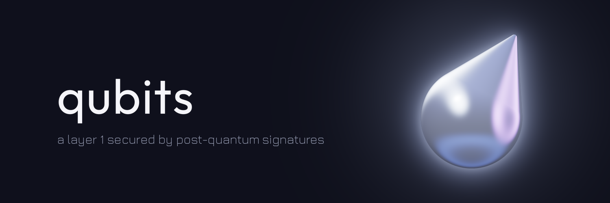

Qubits is a layer 1 for keeping assets safe, and moving them, after quantum computers break today's signatures.

- **Post-quantum accounts.** Every account signs with a NIST standard: ML-DSA-65 by default, SLH-DSA for cold keys. Accounts can be M-of-N and mix the two.
- **Vaults.** A vault's outgoing transfers wait out a delay, and a separate recovery key can cancel them and replace the owner. A stolen key has time to be stopped.
- **Consensus.** Pipelined Moonshot, with a block every network delay and finality after three. Validators sign with ML-DSA and talk over TLS 1.3 with a hybrid X25519 and ML-KEM key exchange.
- **Contracts.** WebAssembly on a metered, deterministic VM.
- **Wallet.** A Chrome extension. Keys stay encrypted in your browser.

Mainnet is not live yet, and the code has not been audited. The [status page](https://qubits.sh/docs/status) says what exists and what doesn't.

**Website:**  [qubits.sh](https://qubits.sh) 
**Docs:**     [qubits.sh/docs](https://qubits.sh/docs) 
**X:**        [@QubitsSH](https://x.com/QubitsSH) 
**Telegram:** [t.me/qubitssh](https://t.me/qubitssh)

BITS on Ethereum is only [`0x000000000003dDef204b9B32c29c57f293Ae5599`](https://etherscan.io/token/0x000000000003dDef204b9B32c29c57f293Ae5599). Any other contract using the name is not ours.
